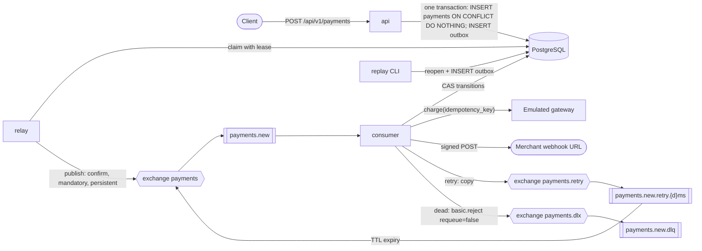

# Payments service

[](https://github.com/Gevernus/payments-service/actions/workflows/ci.yml)

An asynchronous payment-processing service: it accepts a payment over HTTP, charges it through an emulated gateway from a queue consumer, and notifies the merchant with a signed webhook.
Stack: Python 3.13, FastAPI, Pydantic v2, SQLAlchemy 2.0 async + asyncpg, Alembic, PostgreSQL 17, RabbitMQ 4.1 via FastStream, Docker Compose.

What it does:

- `POST /api/v1/payments` stores the payment and an outbox event in one transaction and answers 202. A retry with the same `Idempotency-Key` returns the same payment.
- A relay publishes outbox events to RabbitMQ. One consumer charges the payment through an emulated gateway, updates the status and POSTs a signed webhook.
- A failed webhook is retried after 5 s and 10 s. After 3 attempts the message goes to the DLQ and the payment is marked `dead_lettered`. The merchant deduplicates by the `webhook-id` header.

## Quick start

No `.env` file is needed; every value has a development default. The first run must include
`--build`, because the `api` service builds the image that every application service runs.

```bash
docker compose up -d --build --wait     # or: make up
```

| Service | Address | Purpose |
|---|---|---|
| `api` | http://127.0.0.1:8000 | the HTTP API; Swagger UI at `/docs` (click "Authorize" and paste the API key) |
| `webhook-receiver` | http://127.0.0.1:9000 | demo merchant; `GET /received?payment_id=...` lists what it got |
| `rabbitmq` | http://127.0.0.1:15672 | management UI, user `payments`, password `payments` |

The default API key is `dev-only-api-key-not-for-production-use-0000`. To receive webhooks on your own listener
on the host, use `http://host.docker.internal:PORT/...` as `webhook_url`; other private addresses are rejected
with 422 (see Deviations). Stop and remove the volumes with `make down` (`docker compose down -v`).

## Smoke check (about three minutes)

The gateway outcome is a deterministic function of the `Idempotency-Key`, so the key picks the
outcome: `demo-ok` succeeds, `demo-declined` is declined. The webhook receiver answers by path:
`/hooks/ok`, `/hooks/fail/2` (503 to the first two POSTs of a `webhook-id`, then 200), `/hooks/status/404`.

```bash
export API_KEY=dev-only-api-key-not-for-production-use-0000

# 1. Success: the gateway succeeds, one webhook.
curl -si http://127.0.0.1:8000/api/v1/payments -H "X-API-Key: $API_KEY" \
  -H "Idempotency-Key: demo-ok" -H "Content-Type: application/json" -d @examples/payment.json
# 2. Decline: same body, a declining key. The payment ends `failed`; the webhook is still sent.
curl -s http://127.0.0.1:8000/api/v1/payments -H "X-API-Key: $API_KEY" \
  -H "Idempotency-Key: demo-declined" -H "Content-Type: application/json" -d @examples/payment.json
# 3. Flaky webhook: /hooks/fail/2 -> 3 POSTs (attempt 1, +5 s, +10 s) -> delivered.
curl -s http://127.0.0.1:8000/api/v1/payments -H "X-API-Key: $API_KEY" \
  -H "Idempotency-Key: demo-flaky" -H "Content-Type: application/json" -d @examples/payment-flaky.json
# 4. Permanent failure: /hooks/status/404 -> 1 POST -> DLQ. A 404 is not retried.
curl -s http://127.0.0.1:8000/api/v1/payments -H "X-API-Key: $API_KEY" \
  -H "Idempotency-Key: demo-404" -H "Content-Type: application/json" -d @examples/payment-404.json
```

Response: 202 with `Location` and `Idempotent-Replayed: false` headers and `{"payment_id", "status": "pending", "created_at"}`.

About 20 seconds later (gateway 2 to 5 s, then the retry ladder), with `PID` set to a `payment_id` from above:

```bash
PID=<payment_id>
curl -s http://127.0.0.1:8000/api/v1/payments/$PID -H "X-API-Key: $API_KEY"   # status + delivery
curl -s "http://127.0.0.1:9000/received?payment_id=$PID&compact=1"           # what the merchant got
docker compose exec rabbitmq rabbitmqctl list_queues name messages            # 1 message in payments.new.dlq
docker compose exec consumer python -m payments.cli replay dead --payment-id $PID   # new budget for a dead payment
```

Expected: `demo-404` is `succeeded` with `delivery.state = dead_lettered`, `attempts: 1`, `last_error: http_404`;
`demo-flaky` is `delivered` with `attempts: 3` and three receiver records with one `webhook_id`; `demo-declined` is
`status: failed` and `delivered`. After `replay dead`, the 404 payment gets one more POST and is dead-lettered again.

## Ten-minute reading map

1. **Creating a payment.** `src/payments/services/payments.py::PaymentService.create`: `check_url`, then one transaction with `src/payments/db/queries.py::insert_payment_if_absent` (`ON CONFLICT DO NOTHING RETURNING`) and `src/payments/db/queries.py::add_outbox_event`; the loser compares fingerprints.
2. **The relay.** `src/payments/workers/relay.py::OutboxRelay.run_once`: claim with a lease (`src/payments/db/queries.py::claim_outbox`, the `FOR UPDATE SKIP LOCKED` statement), publish with confirms and `mandatory` outside any transaction, then `src/payments/db/queries.py::delete_published`, which deletes a row only if it was not re-claimed meanwhile.
3. **The delivery automaton.** The conditional `UPDATE ... RETURNING` statements (compare-and-set, CAS below) in `src/payments/db/queries.py`: `begin_attempt`, `finalize`, `mark_delivered`, `mark_dead`, `mark_exhausted`, `record_error`, `reopen`. Every transition of a payment goes through one of them; the budget is 3 attempts per payment, and a replay grants 3 more.
4. **One consumer pass.** `src/payments/services/processing.py::Processor.process` and the outcome table in its docstring; `_no_attempt` decides what a refused attempt means.
5. **Outcome to ack, copy or reject.** `src/payments/workers/consumer.py::handle_payment_event` and `_copy`: `Done` acks, `RetryLater` copies into the retry queue and then acks, `DeadLetter` raises `RejectMessage`; a database error defers.
6. **The topology.** `src/payments/messaging/topology.py`: `MAIN_QUEUE`, `DEAD_LETTER_QUEUE`, `retry_queue`, `declare_core`, `declare_retry_ladder`.

Optional: the sender `src/payments/webhooks/sender.py::HttpWebhookSender` (signing in `src/payments/webhooks/signing.py::sign`, address pinning in `_post`), the SSRF guard `src/payments/webhooks/guard.py::check_url` and `resolve_checked`, the copy publisher `src/payments/messaging/copies.py::CopyPublisher.publish_until_confirmed`, and the CLI `src/payments/cli.py` over `src/payments/services/replay.py`.

```
src/payments/api/        FastAPI app, routes, problem+json, ApiKeyMiddleware
src/payments/workers/    relay and consumer processes (AsgiFastStream under uvicorn)
src/payments/services/   payments (create, get), processing (Processor), replay, gateway
src/payments/db/         models, session (Db.run), queries (all SQL the guarantees depend on)
src/payments/messaging/  topology, envelope (headers), copies (CopyPublisher)
src/payments/webhooks/   signing, guard (SSRF), sender
src/payments/cli.py      python -m payments.cli replay dead|stuck
migrations/  tools/webhook_receiver.py  tools/loadtest.py  tests/{unit,integration,e2e,support}  docs/
```

Processes (`api/`, `workers/`, `cli.py`) depend on `services/`, which depend on `db/`, `webhooks/` and `messaging/`;
nothing imports a process module. The one upward import is `messaging/envelope.py` reading `KnownOutcome` from `services/processing.py`.

## How it works



One consumer pass for one message:

1. `begin_attempt`: a CAS that increments `attempts` only while the budget allows it; no row means duplicate, dead, exhausted or another attempt in flight.
2. If the status is still `pending`: `charge(idempotency_key)` on the gateway, then the CAS `finalize` (`WHERE status = 'pending'`). Both run outside any transaction.
3. One signed POST to `webhook_url`.
4. `mark_delivered`, or `record_error` and a copy of the message into the retry queue, or `mark_dead` and `basic.reject(requeue=false)` into the DLQ.
5. The original is acked only after the copy is confirmed by the broker.

What is retried (design T3). Delays are `5 s`, then `10 s`; the budget of 3 attempts per payment is counted in the database, so duplicates and crashes cannot add POSTs:

| Outcome of an attempt | Behaviour |
|---|---|
| 2xx from the merchant | `delivered` |
| 408, 425, 429, 5xx, connection error, timeout, DNS error; unexpected error; gateway technical failure (the emulator never produces one: the branch exists for a real provider and is covered by tests with a fake gateway) | retried; after the 3rd attempt `dead_lettered` / `max_attempts` |
| 3xx or any other 4xx; TLS certificate error or a non-public address at send time (no POST) | at most one POST, then the DLQ (`permanent`). A 404 means one POST, then the DLQ. |
| gateway decline (`failed`) | not an error: the status is `failed` and the webhook is sent |
| database unavailable, in any step | the message is deferred 5 s without spending an attempt; an attempt that had already started (the gateway was called or a POST was sent) still counts; a 2xx already received travels with the message and is not repeated |

| Topology (exchanges direct and durable, queues quorum) | Role |
|---|---|
| exchange `payments` → queue `payments.new` | the relay publishes here; the consumer reads here; `x-delivery-limit=10` as a broker-side safety net |
| exchange `payments.retry` → queues `payments.new.retry.5000ms`, `payments.new.retry.10000ms` | TTL queues whose dead-letter route goes back to `payments` |
| exchange `payments.dlx` → queue `payments.new.dlq` | dead-letter target of `payments.new`; a journal, never published to directly |

## API

Everything under `/api/v1/` requires `X-API-Key`. `/health/live`, `/health/ready`, `/docs` and
`/openapi.json` do not (probes carry no secrets; the schema is not secret).

`POST /api/v1/payments` with `Idempotency-Key` (required, 1 to 255 printable ASCII characters) and a JSON body:
`amount` (string or number, 2 decimals), `currency` (`RUB`, `USD`, `EUR`), `description`, `metadata` (optional),
`webhook_url` (`http` or `https`, public address); limits are in `/docs`. Response `202 {"payment_id", "status",
"created_at"}` with `Location` and `Idempotent-Replayed` headers. A repeat with the same key and body returns 202
with the original `payment_id` and `created_at`, the current status and `Idempotent-Replayed: true`. The same key
with a different body is 422 `idempotency_key_reused` (draft-ietf-httpapi-idempotency-key-header, section 2.7).

`GET /api/v1/payments/{payment_id}` returns the request fields, `status`, `processed_at` and a
`delivery` object: `state`, `attempts`, `last_attempt_at`, `delivered_at`, `dead_lettered_at`,
`dead_letter_reason`, `last_error`. Errors are `application/problem+json` with a stable `code`:

| Status | `code` | When |
|---|---|---|
| 401 | `unauthorized` | missing or wrong `X-API-Key` (`WWW-Authenticate: APIKey`) |
| 400 | `idempotency_key_missing`, `idempotency_key_invalid` | no header, or characters outside `\x21-\x7E` |
| 422 | `validation_error`, `idempotency_key_reused`, `webhook_url_not_allowed` | bad body; key reused with another body; private or internal webhook address |
| 404 | `payment_not_found` | unknown id on GET |
| 503 | `database_unavailable` | PostgreSQL did not answer within 5 s (`Retry-After: 1`). Nothing was committed; repeating with the same key is safe. |

## Guarantees

| Failure | Behaviour | Proven by |
|---|---|---|
| PostgreSQL down during POST | 503, nothing committed | `test_create_returns_503_when_db_down` |
| RabbitMQ down during POST | 202; the event waits in the outbox, the relay catches up | `test_e2e_broker_outage_outbox_catches_up` |
| Duplicate message (two chains) | shared budget: at most 3 POSTs, one status transition | `test_duplicate_chains_share_attempt_budget` |
| Webhook 5xx three times | exactly 3 POSTs, then the DLQ; `max_attempts` | `test_retry_ladder_exactly_three_posts_then_dlq` |
| Webhook 4xx | 1 POST, then the DLQ; `permanent` | `test_permanent_goes_to_dlq_after_one_post` |
| Database fails after a 2xx | the outcome is carried in the deferred message; the POST is not repeated | `test_db_down_after_delivery_persists_without_resend` |
| SIGKILL of the consumer during a webhook | redelivery starts a new attempt; the gateway is not called again | `test_consumer_sigkill_during_webhook` |
| Relay crashes after the confirm | the event is published again with the same `message_id` | `test_relay_crash_after_confirm_republishes_same_message_id` |

Not guaranteed (the full matrix, with the test behind every row, is in [docs/guarantees.md](docs/guarantees.md)):

- Exactly-once webhook delivery: the merchant deduplicates by `webhook-id`.
- Delivery to a merchant that keeps failing: after 3 attempts the payment is `dead_lettered`, and only an explicit replay grants 3 more.
- Spacing of duplicate chains: chains of one payment share the attempt budget but are not serialised, so they can spend it close together instead of 5 s and 10 s apart.
- Recovery of a `pending` payment whose message was lost (broker delivery limit, handler bug): it requires `replay stuck`.

## Assignment requirement → file

| Requirement | Where |
|---|---|
| Models and migrations for `payments` and `outbox` | `src/payments/db/models.py`, `migrations/versions/0001_initial.py` |
| Endpoints: create and read a payment | `src/payments/api/routes.py`, `src/payments/schemas.py` |
| One consumer that does everything | `src/payments/workers/consumer.py`, `src/payments/services/processing.py` |
| Outbox pattern | `src/payments/services/payments.py`, `src/payments/workers/relay.py`, `src/payments/db/queries.py` |
| Retry: 3 attempts with exponential backoff | `src/payments/db/queries.py::begin_attempt` (budget), `src/payments/config.py::retry_delays_ms`, `src/payments/messaging/topology.py::retry_queue` |
| Dead letter queue | `src/payments/messaging/topology.py::DEAD_LETTER_QUEUE`, `RejectMessage` in the handler, `src/payments/cli.py` for replay |
| Gateway emulation (2 to 5 s, 90% success); webhook with retries | `src/payments/services/gateway.py::EmulatedGateway`; `src/payments/webhooks/sender.py`, `src/payments/webhooks/signing.py` |
| Idempotency key; `X-API-Key` on all endpoints | `src/payments/db/queries.py::insert_payment_if_absent`, `src/payments/fingerprint.py`; `src/payments/api/app.py::ApiKeyMiddleware` |
| Compose with postgres, rabbitmq, api, consumer; README with examples | `compose.yaml`, `Dockerfile`, `compose.e2e.yaml` (end-to-end suite); this file, `examples/`, `docs/` |

## Deviations and interpretations

The full list is design §1 (T1 to T15). The rows a reader may question:

- **A gateway decline is final** (T1, [ADR 1](docs/decisions.md#1-a-gateway-decline-is-final)): `failed` is a business outcome and is notified, not retried. Only technical failures are retried.
- **The attempt budget lives in the database** (T2, T3, [ADR 5](docs/decisions.md#5-the-payment-row-is-the-source-of-truth-delivery-automaton-and-attempt-budget)): 3 attempts per payment, 5 s and 10 s between them, and a replay grants 3 more; 3xx, 4xx, TLS and SSRF failures go to the DLQ after one POST.
- **Extra compose services** (T5, T6, [ADR 11](docs/decisions.md#11-processes-and-compose-layout)): `migrate`, `relay` and `webhook-receiver` next to the four required ones; the consumer is still the only place that processes a payment.
- **400 vs 422** (T8, [ADR 3](docs/decisions.md#3-api-idempotency)): a missing or malformed key is 400; the same key with a different body is 422, as in draft-ietf-httpapi-idempotency-key-header.
- **`http` and `https`, public addresses only** (T10, [ADR 10](docs/decisions.md#10-standard-webhooks-and-the-ssrf-policy-with-address-pinning)): the address is checked at create time and again at send time. Compose sets `WEBHOOK_INTERNAL_HOSTS=webhook-receiver,host.docker.internal`, which opens the host's loopback services to webhooks in the demo; in production the list is empty.
- **The DLQ is a journal; replay goes through the database** (T15, [ADR 7](docs/decisions.md#7-the-dlq-is-a-journal-native-reject-replay-goes-through-the-database)): the dead state and its reason are in the payment row; `replay dead` reopens it with 3 more attempts through the outbox.

Left out on purpose ([docs/decisions.md](docs/decisions.md) §12): metrics and alerts on DLQ size, outbox age and stuck payments; a scheduled reconciler running `replay stuck`; per-merchant webhook secrets with rotation; retention for idempotency keys and old payments; per-client API keys; RabbitMQ policies instead of queue arguments in code; a body size limit at the ingress.

## Tests

```bash
make test     # uv run pytest -m "not e2e": unit + integration (PostgreSQL and RabbitMQ via testcontainers)
make e2e      # compose stack with compose.e2e.yaml, then pytest -m e2e, then down -v
make ci       # ruff check, ruff format --check, mypy --strict, REQUIRE_INFRA=1 pytest -m "not e2e"
```

Integration tests start PostgreSQL and RabbitMQ with testcontainers, or use existing instances from
`TEST_DATABASE_URL`, `TEST_RABBITMQ_URL`, `TEST_RABBITMQ_MANAGEMENT_URL` and `TEST_RABBITMQCTL`.
Without infrastructure they are skipped; `REQUIRE_INFRA=1` (set in CI) turns that into a failure.
They cover concurrent POSTs with one key, relay crashes and lost leases, the exact retry ladder, duplicate
chains sharing the budget, database outages in the consumer, and SIGKILL/SIGTERM of a real consumer process.
Failures are injected with TCP proxies (`tests/support/tcp_proxy.py`). `tests/integration/test_guarantees_doc.py`
fails when a test name in `docs/guarantees.md` or a path in this README stops resolving.

Load test results (intake, end-to-end latency, broker outage) are in [docs/load-testing.md](docs/load-testing.md).

## Configuration

| Process | Variable | Default | Note |
|---|---|---|---|
| api | `API_KEY` | required | at least 32 characters |
| consumer, receiver | `WEBHOOK_SECRET` | required | `whsec_` + base64 key (Standard Webhooks) |
| api, consumer | `WEBHOOK_INTERNAL_HOSTS` | empty | host names allowed to resolve to private addresses; demo only |
| consumer | `GATEWAY_MIN_DELAY_S`, `GATEWAY_MAX_DELAY_S`, `GATEWAY_SUCCESS_RATE` | 2, 5, 0.9 | the emulation |
| consumer | `RETRY_MAX_ATTEMPTS`, `RETRY_BASE_DELAY_MS` | 3, 5000 | 3 is the assignment's budget; a new delay declares new retry queues and leaves the old ones |

All variables are in `src/payments/config.py` and design §9; compose sets development values for all of them.
Queue arguments (`x-dead-letter-*`, `x-delivery-limit`, `x-overflow`) are constants in `src/payments/messaging/topology.py`;
RabbitMQ refuses to redeclare a queue with different arguments, so changing them on an existing volume requires `docker compose down -v`.

## Further reading

[docs/guarantees.md](docs/guarantees.md) → [docs/decisions.md](docs/decisions.md) → [docs/design.md](docs/design.md) → [docs/load-testing.md](docs/load-testing.md).
