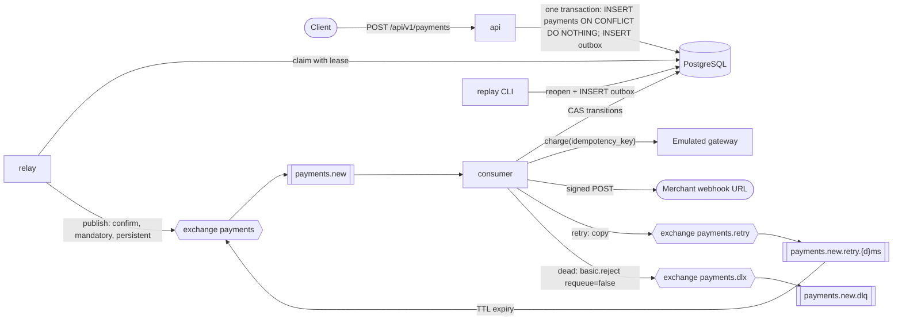
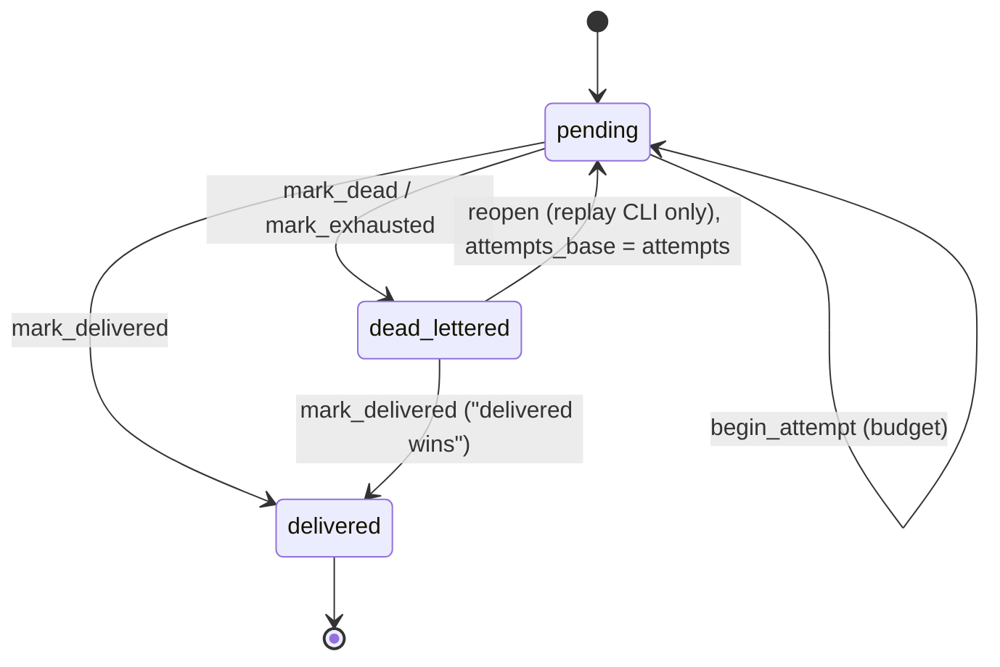
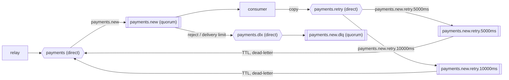

# Payment processing service: design specification

This document was written before the implementation. It describes what the service does, how
each requirement of the assignment is interpreted, and which mechanisms provide the delivery
guarantees. Design decisions with their alternatives are in [decisions.md](decisions.md); the
per-failure behaviour and the tests that verify it are in [guarantees.md](guarantees.md).

---

## 0. Goal

An asynchronous payment-processing microservice that satisfies the assignment and can be read
end to end in 20 to 30 minutes. The service accepts payment requests over HTTP, processes them
through an emulated payment gateway and notifies the merchant of the result with a webhook.

The central design choice is that the `payments` row is the only source of truth about
processing. Its delivery state and its attempt budget change only through compare-and-set
(CAS) statements in PostgreSQL; RabbitMQ carries messages and implements delays. This bounds
processing to three attempts, and webhook delivery to three POSTs, per payment, regardless of
duplicate messages, crashes and publish failures.

Out of scope: metrics and tracing, multi-tenancy, Kubernetes manifests, change data capture,
RabbitMQ policies, an automatic reconciler, request body size limits (an ingress concern).

---

## 1. Interpretation of the requirements

The assignment leaves several points open. Each row records the requirement, the decision
taken and the reason.

| # | Requirement | Decision | Rationale |
|---|---|---|---|
| T1 | "90% success, 10% error" | A gateway decline is a business outcome: the payment becomes `failed` and the webhook is sent. A decline is not retried. | Retrying a decline would eventually turn a declined payment into a successful one. |
| T2 | "Retry: 3 attempts with exponential backoff"; "DLQ after 3 attempts" | Three processing attempts per payment, counted in the database. An attempt is a consumer pass that started work (a gateway call and/or one webhook POST). Delays between attempts are `base * 2^(n-1)` (5 s, 10 s). At most 3 POSTs per payment; a new budget is granted only by an explicit replay. | One ladder serves both retry and DLQ. A budget in the database survives duplicate messages, crashes and publish failures. |
| T3 | "Retry on delivery errors" | Retried: network errors, timeouts, DNS errors, 408, 425, 429, 5xx, a technical gateway failure, unexpected errors. Sent to the DLQ after one attempt: 3xx, other 4xx, TLS errors, SSRF blocks. | A permanent rejection is not fixed by repeating the request. The README states it plainly: a 404 means one POST, then the DLQ. |
| T3a | "DLQ after 3 attempts" | A message may be delivered more than 3 times without spending attempts: when the database is unavailable (the message waits), or when the outcome is already known and only needs to be written. | These are not processing failures. |
| T4 | "X-API-Key on all endpoints" | Everything under `/api/v1/*` requires the key. `/health/*` does not (probes do not carry secrets), nor do `/docs` and `/openapi.json` (the schema is not secret; Swagger UI sends the key through "Authorize"). | Both exceptions are explained in the README. |
| T5 | "compose with postgres, rabbitmq, api, consumer" | Additional services: `migrate`, `relay`, `webhook-receiver`. | Migrations run once before the application; the relay is a separate process; the receiver makes the demo and end-to-end tests self-contained. |
| T6 | "One consumer that does everything" | One consumer on `payments.new`. The relay only publishes the outbox. | The consumer stays the single place where a payment is processed. |
| T7 | Response to POST | A repeat with the same key and body returns 202 with the same `payment_id` and `created_at`, the current `status`, and `Idempotent-Replayed: true`. | Idempotency-Key draft, section 2.6. |
| T8 | "Idempotency-Key (required)" | Missing or malformed key: 400. Same key with a different body: 422. | Idempotency-Key draft, section 2.7. |
| T9 | Amount is "decimal" | `0 < amount <= 9 999 999 999.99`, at most 2 fractional digits; as a string it must match `^\d{1,10}(\.\d{1,2})?$`. | RUB, USD and EUR all have two minor-unit digits; a JSON number is parsed as a float and only about 15 significant digits are exact. |
| T10 | `webhook_url` | Both `http` and `https` are accepted; the address must be public (SSRF policy). In compose, `webhook-receiver` and `host.docker.internal` are allowed. | The security property is in the address, not in the scheme. |
| T11 | Webhook format | Standard Webhooks. | An open specification with reference verification libraries. |
| T12 | Emulation | Outcome and delay are deterministic functions of the gateway idempotency key (`payment_id`). Hints `metadata.emulator_outcome` in `{succeeded, failed, error}` are honoured only when `GATEWAY_OUTCOME_HINTS=true` (the compose demo mode). | Matches the behaviour of a real payment provider for a repeated key; makes demos and tests deterministic. |
| T13 | Tables `payments` and `outbox` | Exactly these two tables. | One webhook per payment, so delivery state fits in the payment row. |
| T14 | `description` | Optional, defaults to `""`, at most 1000 characters. | |
| T15 | DLQ | The DLQ is a journal of messages that were not processed. Reprocessing is done by a CLI over the database through the outbox: `replay` (dead payments, new budget) and `replay --stuck-pending --older-than T` (payments stuck in `pending`, for example after the broker's delivery limit moved a message to the DLQ). Moving a message out of the DLQ in the management UI is harmless: for a `dead_lettered` payment it is rejected to the DLQ again; for a `pending` payment processing resumes normally. | The truth about a dead payment is in the database; the DLQ cannot override it. |

---

## 2. Architecture

### 2.1 Processes

| Process | Command | Responsibility |
|---|---|---|
| `api` | `uvicorn payments.api.app:create_app --factory` | HTTP API |
| `relay` | `uvicorn payments.workers.relay:create_app --factory` (AsgiFastStream) | outbox to RabbitMQ |
| `consumer` | `uvicorn payments.workers.consumer:create_app --factory` (AsgiFastStream) | `payments.new` to processing, retry and DLQ |
| `migrate` | `alembic upgrade head` | schema, one-shot |
| `webhook-receiver` | `uvicorn --app-dir tools webhook_receiver:app` | demo and end-to-end receiver |
| CLI | `python -m payments.cli replay [--reason R] [--payment-id ID] [--limit N]` | return dead payments to processing |

Every process runs `SELECT 1` at startup, and the relay and consumer also connect to the
broker. A configuration error kills the process instead of turning into an endless wait for
the database.

### 2.2 Flow



The consumer pass for one message:

```
begin_attempt (CAS, budget) -> charge(idempotency_key) -> finalize status (CAS)
    -> POST webhook -> mark_delivered | mark_dead (CAS)
retry: copy -> payments.retry -> payments.new.retry.{d}ms -> TTL -> payments
dead:  basic.reject(requeue=false) -> DLX payments.dlx -> payments.new.dlq
```

Rule: **no database transaction is open during a network call.** Safety nets:
`statement_timeout`, `idle_in_transaction_session_timeout` and `lock_timeout` in the
connection's `server_settings`, plus a client-side deadline on every database call (section 7.1).

### 2.3 Repository layout

```
src/payments/
  config.py            Settings and require_*() accessors for secrets
  logging.py
  money.py
  schemas.py           PaymentCreate, PaymentAccepted, PaymentData, PaymentOut(PaymentData), PaymentEvent
  fingerprint.py
  errors.py            domain errors, problem+json, ErrorCode, DeadReason
  db/
    models.py
    session.py         engine, sessionmaker, is_db_unavailable(), db_call()
    queries.py         all SQL that the guarantees depend on
  services/
    payments.py        create, get
    processing.py      Processor.process() -> Outcome; KnownOutcome
    replay.py          reopen + outbox (CLI)
    gateway.py
  webhooks/            signing.py, guard.py, sender.py
  messaging/
    topology.py        constants, declare_core(), declare_retry_ladder()
    envelope.py        message headers: parsing and allow-list
    copies.py          CopyPublisher: dedicated connection, publish until confirmed
  api/                 app.py, routes.py
  workers/             relay.py, consumer.py
  cli.py
migrations/  tools/webhook_receiver.py  tests/  docs/  Dockerfile  compose*.yaml
```

Ownership:

- **Processor** is the only code in the consumer that writes to `payments`; every transition is
  a CAS statement in `queries.py`.
- **The handler** owns the message (Envelope, CopyPublisher, ack and reject) and imports only
  `Processor`, `envelope`, `copies` and `topology`.
- **Replay** is a service over the database.

---

## 3. Data model

### 3.1 `payments`

```sql
CREATE TABLE payments (
  id                   uuid          PRIMARY KEY,
  amount               numeric(18,2) NOT NULL,
  currency             varchar(3)    NOT NULL,
  description          varchar(1000) NOT NULL DEFAULT '',
  metadata             jsonb         NOT NULL DEFAULT '{}',
  status               varchar(16)   NOT NULL DEFAULT 'pending',
  idempotency_key      varchar(255)  NOT NULL,
  request_fingerprint  varchar(72)   NOT NULL,
  webhook_url          varchar(2048) NOT NULL,
  created_at           timestamptz   NOT NULL DEFAULT now(),
  processed_at         timestamptz,
  -- processing and delivery
  delivery_state       varchar(16)   NOT NULL DEFAULT 'pending',
  attempts             integer       NOT NULL DEFAULT 0,   -- processing attempts started, in total
  attempts_base        integer       NOT NULL DEFAULT 0,   -- attempts at the last replay; budget used = attempts - attempts_base
  last_attempt_at      timestamptz,
  delivered_at         timestamptz,
  dead_lettered_at     timestamptz,
  dead_letter_reason   varchar(32),
  last_error           varchar(64),                        -- code of the last failure
  CONSTRAINT uq_payments_idempotency_key   UNIQUE (idempotency_key),
  CONSTRAINT ck_payments_amount_positive   CHECK (amount > 0),
  CONSTRAINT ck_payments_currency          CHECK (currency IN ('RUB','USD','EUR')),
  CONSTRAINT ck_payments_status            CHECK (status IN ('pending','succeeded','failed')),
  CONSTRAINT ck_payments_processed_at      CHECK ((status = 'pending') = (processed_at IS NULL)),
  CONSTRAINT ck_payments_delivery_state    CHECK (delivery_state IN ('pending','delivered','dead_lettered')),
  CONSTRAINT ck_payments_delivered_at      CHECK ((delivery_state = 'delivered') = (delivered_at IS NOT NULL)),
  CONSTRAINT ck_payments_delivered_final   CHECK (delivery_state <> 'delivered' OR status <> 'pending'),
  CONSTRAINT ck_payments_dead_lettered_at  CHECK ((delivery_state = 'dead_lettered') = (dead_lettered_at IS NOT NULL)),
  CONSTRAINT ck_payments_dead_reason       CHECK ((delivery_state = 'dead_lettered') = (dead_letter_reason IS NOT NULL)
                                                  AND (dead_letter_reason IS NULL OR dead_letter_reason IN ('max_attempts','permanent','unroutable'))),
  CONSTRAINT ck_payments_attempts          CHECK (attempts >= attempts_base AND attempts_base >= 0)
);
```

ORM notes: SQLAlchemy 2.0.x; the Python attribute is `meta = mapped_column("metadata", JSONB)`
because `metadata` is reserved on declarative models. Enums use `native_enum=False,
create_constraint=False, values_callable=...`; CHECK constraints live only in the migration.
`DeadReason` is a `StrEnum` in `errors.py`.

### 3.2 Delivery automaton

`status` is the business result (`pending`, `succeeded`, `failed`). `delivery_state` is the
processing and notification state. All transitions are CAS statements in `queries.py`.



| Transition | SQL |
|---|---|
| `begin_attempt(id, max)` | `UPDATE ... SET attempts=attempts+1, last_attempt_at=now() WHERE id=:id AND delivery_state='pending' AND attempts-attempts_base < :max RETURNING *, attempts-attempts_base AS attempt_no, attempts_base AS epoch` |
| `mark_exhausted(id, max, stale)` | `UPDATE ... SET delivery_state='dead_lettered', dead_lettered_at=now(), dead_letter_reason='max_attempts', last_error=COALESCE(last_error, 'crash_loop') WHERE id=:id AND delivery_state='pending' AND attempts-attempts_base >= :max AND last_attempt_at < now() - :stale RETURNING id` |
| `finalize(id, s)` | `UPDATE ... SET status=:s, processed_at=now() WHERE id=:id AND status='pending' RETURNING *` |
| `mark_delivered(id)` | `UPDATE ... SET delivery_state='delivered', delivered_at=now(), dead_lettered_at=NULL, dead_letter_reason=NULL, last_error=NULL WHERE id=:id AND delivery_state IN ('pending','dead_lettered')` |
| `mark_dead(id, epoch, reason, code)` | `UPDATE ... SET delivery_state='dead_lettered', dead_lettered_at=now(), dead_letter_reason=:reason, last_error=COALESCE(:code, last_error) WHERE id=:id AND delivery_state='pending' AND attempts_base=:epoch RETURNING delivery_state`; on 0 rows, `SELECT delivery_state, attempts_base` and return the actual state to the caller |
| `record_error(id, epoch, code)` | `UPDATE ... SET last_error=:code WHERE id=:id AND delivery_state='pending' AND attempts_base=:epoch` |
| `reopen(id)` | `UPDATE ... SET delivery_state='pending', dead_lettered_at=NULL, dead_letter_reason=NULL, last_error=NULL, attempts_base=attempts WHERE id=:id AND delivery_state='dead_lettered' RETURNING id` |

`mark_exhausted` fires only when the budget is spent **and** the last attempt is stale (not in
flight). That distinguishes a crash loop from a slow attempt of another message chain, and
`COALESCE` keeps the real last error instead of overwriting it with `crash_loop`.

**Budget epoch** = `attempts_base`. An outcome obtained in an old epoch (before a replay) cannot
kill the new one: `mark_dead` and `record_error` are fenced by the epoch. `mark_delivered` is
not fenced: "delivered wins" in any epoch.

### 3.3 Source of truth

| Fact | Source of truth |
|---|---|
| Payment status, whether the webhook was delivered, whether the payment is dead, how many attempts were made | the `payments` row (CAS transitions) |
| Delay before the next attempt | TTL of the retry queue |
| What is in the DLQ | the DLQ itself, as a journal; it may contain duplicates (a dead payment's message rejected again) |
| A malformed message without a `payment_id` | the DLQ only |

### 3.4 `outbox`

```sql
CREATE TABLE outbox (
  id           uuid         PRIMARY KEY,               -- event_id = AMQP message_id
  payment_id   uuid         NOT NULL REFERENCES payments(id),
  event_type   varchar(64)  NOT NULL,                  -- payment.created | payment.replay_requested
  routing_key  varchar(255) NOT NULL,                  -- payments.new
  payload      jsonb        NOT NULL,
  headers      jsonb        NOT NULL DEFAULT '{}',
  created_at   timestamptz  NOT NULL DEFAULT now(),
  available_at timestamptz  NOT NULL DEFAULT now(),
  attempts     integer      NOT NULL DEFAULT 0 CHECK (attempts >= 0),
  last_error   varchar(100)
);
CREATE INDEX ix_outbox_available_at ON outbox (available_at);
```

### 3.5 Migrations

One hand-written revision. `env.py` is async and runs `SET lock_timeout='5s'`. Tests check that
the migration matches the models, that every constraint exists, and that downgrade followed by
upgrade succeeds.

---

## 4. HTTP API

### 4.1 Common behaviour

- Prefix `/api/v1`. Errors are RFC 9457 `application/problem+json` with `type`, `title`,
  `status`, `detail`, `code`; a 422 also carries `errors`.
- `ApiKeyMiddleware` is plain ASGI on the `/api/` prefix: the key is checked before the body
  is read. `Security(APIKeyHeader(auto_error=False))` on the router exists only for the OpenAPI
  schema (commented "enforced by ApiKeyMiddleware").
- Response precedence: **401, then 422, then 400 (Idempotency-Key), then business errors.**
  FastAPI turns a `ValueError` or `RecursionError` raised while parsing the body into a 400; the
  handler maps it to 422 `json_invalid` when `isinstance(exc.__cause__, (ValueError,
  RecursionError))`.
- `is_db_unavailable(exc)` maps to 503; any other `DBAPIError` is a 500.
- An `X-Request-Id` middleware propagates or generates a request id.

### 4.2 Authentication

`secrets.compare_digest(raw_header_bytes, key_bytes)`. A missing or wrong key returns 401 with
`WWW-Authenticate: APIKey`. `API_KEY` must be at least 32 characters.

### 4.3 `POST /api/v1/payments`

| Field | Rules |
|---|---|
| `amount` | a number, or a string matching `^\d{1,10}(\.\d{1,2})?$`; `Decimal(gt=0, max_digits=12, decimal_places=2)`; `quantize(Decimal("0.01"))` |
| `currency` | `RUB`, `USD` or `EUR` |
| `description` | default `""`, at most 1000 characters, no `\x00` |
| `metadata` | default `{}`; at most 16 KiB serialized; depth at most 10; no `\x00`; finite numbers only |
| `webhook_url` | `HttpUrl`, at most 2048 characters (syntax only); the address policy is applied in the service and fails with 422 `webhook_url_not_allowed` |

`money.py` explains `max_digits=12`: a JSON number is decoded as a float, a float holds about 15
significant decimal digits exactly, and a 17-digit amount would be altered silently. Twelve
digits (ten integer, two fractional) stay well inside the exact range.

`Idempotency-Key`: 1 to 255 characters in the range `\x21-\x7E`, validated in the endpoint;
otherwise 400.

Request fingerprint:

```python
_NUM = "\x00num:"   # NUL is rejected in input strings, so the tag cannot collide with data

def _canon(v):
    if v is None or isinstance(v, (bool, str)):
        return v
    if isinstance(v, (int, float)):
        d = Decimal(repr(v)) if isinstance(v, float) else Decimal(v)
        return _NUM + format(Decimal(0) if d == 0 else d.normalize(), "f")
    if isinstance(v, list):
        return [_canon(x) for x in v]
    return {k: _canon(x) for k, x in v.items()}

# fingerprint = "v1:" + sha256(canonical JSON of {amount, currency, description, metadata, webhook_url})
```

Numbers are canonicalised so that `1`, `1.0` and `1.00` in metadata produce the same
fingerprint, and `-0` equals `0`. The `v1:` prefix allows the canonical form to change later
without comparing incompatible fingerprints.

Service flow:

1. `check_url(webhook_url)` (no I/O; section 8.4).
2. One transaction: `INSERT ... ON CONFLICT (idempotency_key) DO NOTHING RETURNING ...`.
   - The winner inserts the outbox event `payment.created` in the same transaction.
   - Otherwise `SELECT` the existing row and compare fingerprints; a mismatch is 422.
3. `COMMIT` before the response is sent.

Response: `202 {"payment_id", "status", "created_at"}` with `Location` and
`Idempotent-Replayed` headers.

### 4.4 `GET /api/v1/payments/{payment_id}`

```json
{
  "payment_id": "...", "amount": "100.00", "currency": "RUB", "description": "", "metadata": {},
  "status": "succeeded", "idempotency_key": "...", "webhook_url": "https://...",
  "created_at": "...", "processed_at": "...",
  "delivery": {"state": "delivered", "attempts": 1, "last_attempt_at": "...", "delivered_at": "...",
               "dead_lettered_at": null, "dead_letter_reason": null, "last_error": null}
}
```

`last_error` is an `ErrorCode` value: `http_<code>`, `connect_error`, `timeout`, `dns_error`,
`tls_error`, `blocked:<reason>`, `redirect`, `gateway_unavailable`, `unexpected`, `crash_loop`.
Exception class names appear only in logs.

### 4.5 Health

`/health/live` returns 200. `/health/ready` runs `SELECT 1` and reads the outbox backlog within
`asyncio.timeout(2)`. The API does not check the broker: it does not use it.

---

## 5. Outbox relay

1. Startup (`on_startup`): `SELECT 1` and `declare_core()`; any error terminates the process.
   The relay loop is a task created in `after_startup`. Its done-callback logs CRITICAL and sends
   `SIGTERM` to its own process if the task ended for any reason other than cancellation.
2. Claim:

   ```sql
   WITH due AS MATERIALIZED (
     SELECT id FROM outbox WHERE available_at <= now()
     ORDER BY available_at LIMIT :batch FOR UPDATE SKIP LOCKED)
   UPDATE outbox o SET attempts = o.attempts + 1, available_at = now() + :lease
   FROM due WHERE o.id = due.id
   RETURNING o.id, o.payment_id, o.event_type, o.routing_key, o.payload, o.headers, o.attempts;
   ```

   The claim commits immediately. The lease (`available_at` in the future) hides the row from
   other relays; database time is used so that relay clocks do not matter.
3. Publish outside any transaction, concurrently: `persist`, `mandatory`, an explicit timeout,
   `message_id` = event id, `message_type` = event type, `correlation_id` = payment id. Success
   means `Basic.Ack` only; the channel has publisher confirms and `on_return_raises=True`, so an
   unroutable message is a failure.
4. Record the result with fencing: on success `DELETE ... WHERE (id, attempts) IN (...)`; on a
   per-message failure set `available_at = now() + backoff` and `last_error`. If the lease was
   lost and another relay re-claimed the row, `attempts` differs and the write is a no-op.
5. Loop: no broker connection means no claims. Any exception in an iteration triggers a global
   backoff. `last_tick` is updated on every iteration.
6. A row with `attempts >= 10` is logged at ERROR. Health: connection alive, loop task alive and
   `now - last_tick < 60 s`. A settings validator enforces
   `OUTBOX_LEASE_S > 2 * RABBIT_PUBLISH_TIMEOUT_S`.

Event payload: `{"event_id", "payment_id", "occurred_at"}`. `event_type` is `payment.created` or
`payment.replay_requested`; the consumer treats both the same way.

---

## 6. RabbitMQ topology

Image `rabbitmq:4.1.<patch>-management-alpine`; FastStream `>=0.7,<0.8`. The only
acknowledgements used are `basic.ack` and `basic.reject(requeue=false)`; `nack` and
`reject(requeue=true)` are not used.



| Exchange (direct, durable) | Purpose |
|---|---|
| `payments` | relay publishes here; TTL queues dead-letter back here |
| `payments.retry` | delay steps |
| `payments.dlx` | DLQ |

| Queue (quorum) | Arguments | Declared by |
|---|---|---|
| `payments.new` | DLX `payments.dlx` with routing key `payments.new.dlq`, `x-dead-letter-strategy=at-least-once`, `x-overflow=reject-publish`, `x-delivery-limit=10` | `declare_core` (relay, consumer) |
| `payments.new.dlq` | `x-delivery-limit=-1` | `declare_core` |
| `payments.new.retry.{d}ms` | `x-message-ttl=d`, DLX `payments` with routing key `payments.new`, `at-least-once`, `reject-publish` | `declare_retry_ladder` (consumer only) |

- Core queue arguments are constants. Changing them on an existing volume requires
  `docker compose down -v`.
- `delays = [base * 2^(i-1) for i in 1..RETRY_MAX_ATTEMPTS-1]`. The delay is part of the queue
  name, so changing the delay declares new queues instead of conflicting with existing ones.
- `x-delivery-limit=10` is a broker-side safety net for messages that come back without an ack
  before reaching `begin_attempt` (a crash before the CAS, or messages sitting in the prefetch
  buffer during a crash). In RabbitMQ 4.1 the `x-delivery-count` header and the limit count
  every previous delivery (crash, connection loss, consumer timeout); later versions count only
  failed deliveries. The handler neither reads nor copies this header. Crashes **after**
  `begin_attempt` spend the payment's budget and end with `max_attempts` in the database.
- With `at-least-once` dead-lettering an unroutable dead letter is retained at the source queue
  instead of being dropped.

---

## 7. Consumer

### 7.1 Processor

```python
@dataclass(frozen=True)
class KnownOutcome:              # the network result is known; only the database write is left
    kind: Literal["delivered", "dead"]
    epoch: int                   # attempts_base in which the outcome was obtained
    reason: DeadReason | None = None
    code: ErrorCode | None = None

Outcome = Done | RetryLater(attempt_no) | DeadLetter

class Processor:
    async def process(self, payment_id: UUID, *, known: KnownOutcome | None = None) -> Outcome:
        if known is not None:
            return await self._persist(payment_id, known)              # no network
        p = await q.begin_attempt(payment_id, self._max_attempts)
        if p is None:
            return await self._no_attempt(payment_id)
        try:
            if p.status is PENDING:
                try:
                    status = await self._gateway.charge(idempotency_key=str(p.id), amount=p.amount,
                                                        currency=p.currency, metadata=p.meta)
                except GatewayUnavailable:
                    return await self._fail(p, "gateway_unavailable")
                p = await q.finalize(p.id, status) or await q.get_payment(p.id)
            result = await self._webhooks.send(p)
        except DatabaseUnavailable:
            raise
        except Exception:
            log.exception("payment.processing_failed")
            return await self._fail(p, "unexpected")
        match result:
            case Delivered():       return await self._persist(p.id, KnownOutcome("delivered", p.epoch))
            case RetryLater(code):  return await self._fail(p, code)
            case Permanent(code):   return await self._persist(p.id, KnownOutcome("dead", p.epoch, PERMANENT, code))

    async def _no_attempt(self, payment_id) -> Outcome:              # no attempt was started
        if await q.mark_exhausted(payment_id, self._max_attempts, self._stale_after):
            return DeadLetter()                                       # budget spent, last attempt stale (crash loop)
        match await q.get_delivery_state(payment_id):
            case None:            return DeadLetter()                 # no such payment
            case "delivered":     return Done()                       # duplicate
            case "dead_lettered": return DeadLetter()                 # reject again; the DLQ gets an entry even after a SIGKILL
            case "pending":       raise AttemptInFlight()              # another chain is working: defer without spending

    async def _fail(self, p, code) -> Outcome:
        if p.attempt_no >= self._max_attempts:
            return await self._persist(p.id, KnownOutcome("dead", p.epoch, MAX_ATTEMPTS, code))
        await q.record_error(p.id, p.epoch, code)
        return RetryLater(p.attempt_no)

    async def _persist(self, payment_id, known) -> Outcome:
        try:
            if known.kind == "delivered":
                await q.mark_delivered(payment_id); return Done()
            state = await q.mark_dead(payment_id, known.epoch, known.reason, known.code)
            return DeadLetter() if state == "dead_lettered" else Done()   # delivered or a newer epoch: not ours
        except DatabaseUnavailable as exc:
            raise DatabaseUnavailable(known=known) from exc
```

The handler treats `AttemptInFlight` like `DatabaseUnavailable` without a known outcome: the
message is deferred by `delays[0]`. The wait is bounded: within `STALE_AFTER_S` the other attempt
either finishes or becomes stale, and then `mark_exhausted` applies.

Properties:

- **At most `max_attempts` POSTs per payment per epoch.** Every POST is preceded by a successful
  `begin_attempt` (a CAS under the budget). Duplicate messages, crashes after `begin_attempt` and
  failed copy publishes all draw from the same budget.
- **Epochs.** Outcomes from an old epoch (a stale chain, a deferred `KnownOutcome`, a message
  moved out of the DLQ) cannot kill a replay: `mark_dead` and `record_error` are fenced by
  `attempts_base`.
- **"Delivered wins"** in any epoch.
- **A database error in the consumer never leads to the DLQ.** `db_call()` converts any driver
  or connection error (`DBAPIError`, `OSError`, `TimeoutError`, `sqlalchemy.exc.TimeoutError`)
  into `DatabaseUnavailable`. The handler defers the message, carrying the `KnownOutcome` if the
  outcome is already known. The `x-deferrals` counter produces a WARNING every 12 deferrals and
  an ERROR after 120. Programming errors outside the driver (`TypeError`, `KeyError`, ...)
  inside an attempt go to `_fail("unexpected")`, spend budget and eventually mark the payment.
  The `is_db_unavailable` predicate is used only by the API (503 versus 500).
- **The gateway is called outside a transaction.** A parallel duplicate calls it with the same
  key, receives the same outcome, and only one `finalize` CAS wins (gateway contract, 8.1).

`db_call()`: every `q.*` call is a short transaction under `asyncio.timeout(DB_CALL_TIMEOUT_S)`.
Engine: `connect_args={"timeout": 3, "command_timeout": 5, "server_settings":
{"statement_timeout": "4000", "lock_timeout": "2000", "idle_in_transaction_session_timeout":
"10000"}}`, `pool_pre_ping=True`.

`is_db_unavailable` (API, 503):

```python
_NET_ERRNO = {errno.ENETUNREACH, errno.EHOSTUNREACH, errno.ENETDOWN, errno.EHOSTDOWN}

def _is_network(e) -> bool:
    return isinstance(e, (ConnectionError, socket.gaierror, TimeoutError)) or \
           (isinstance(e, OSError) and e.errno in _NET_ERRNO)

def is_db_unavailable(exc) -> bool:
    if _is_network(exc) or isinstance(exc, sqlalchemy.exc.TimeoutError):
        return True
    if isinstance(exc, sqlalchemy.exc.DBAPIError) and exc.connection_invalidated:
        return True
    orig = getattr(exc, "orig", None)
    root = getattr(orig, "__cause__", None) or orig
    return _is_network(root) or isinstance(root, (asyncpg.PostgresConnectionError,
                                                  asyncpg.CannotConnectNowError,
                                                  asyncpg.TooManyConnectionsError))
```

Configuration errors (`ClientConfigurationError`, `FileNotFoundError`) are caught by the
`SELECT 1` at process startup, and the process exits.

### 7.2 Handler

```python
copies = CopyPublisher(url)   # not an application broker: its own RabbitBroker on a separate connection
broker = RabbitBroker(url, graceful_timeout=CONSUMER_GRACEFUL_TIMEOUT_S,
                      default_channel=Channel(prefetch_count=CONSUMER_PREFETCH))   # consume only
app = AsgiFastStream(broker, on_startup=[copies.connect, ...], after_shutdown=[copies.close])
# FastStream stops application brokers first; copies is closed in after_shutdown,
# i.e. after in-flight handlers have finished (graceful_timeout).

@broker.subscriber(topology.MAIN, topology.PAYMENTS, ack_policy=AckPolicy.REJECT_ON_ERROR)
async def on_payment_event(event: PaymentEvent, msg: RabbitMessage) -> None:
    env = Envelope.from_message(msg)          # invalid headers are logged and ignored
    bind_contextvars(payment_id=str(event.payment_id), event_id=msg.message_id, request_id=env.request_id)
    try:
        try:
            outcome = await processor.process(event.payment_id, known=env.known_outcome)
        except (DatabaseUnavailable, AttemptInFlight) as exc:
            return await _copy(event, msg, env.deferred(getattr(exc, "known", None)), delays[0])
        match outcome:
            case Done():                 return                                    # ack
            case RetryLater(attempt_no): return await _copy(event, msg, env.retried(), delays[attempt_no - 1])
            case DeadLetter():           raise RejectMessage()                     # requeue=False -> DLX -> DLQ
    finally:
        clear_contextvars()

async def _copy(event, msg, headers, delay_ms) -> None:
    try:
        await copies.publish_until_confirmed(msg, headers, retry_queue(delay_ms))
    except CopyUnroutable:                                  # the topology is broken
        if headers.known_outcome is None:
            with suppress(DatabaseUnavailable):
                await processor.mark_unroutable(event.payment_id)
        raise RejectMessage() from None
```

`CopyPublisher.publish_until_confirmed` publishes the copy to `payments.retry` (`persist`,
`mandatory`) under an explicit `asyncio.timeout(RABBIT_PUBLISH_TIMEOUT_S)` per attempt.
FastStream 0.7 does not pass `timeout=` through to aiormq for `publish`, so under
`Connection.Blocked` the call would otherwise hang forever. It retries with backoff from 0.2 s
to 5 s until the copy is confirmed; a `PublishError` (returned as unroutable) becomes
`CopyUnroutable`; cancellation propagates. A confirmation timeout may mean the copy was in fact
enqueued; the result is two copies, which the budget and the automaton absorb. The original is
acked only after the copy is confirmed. `copies.close()` runs under `asyncio.timeout(5)`
(closing a blocked connection otherwise hangs for 60 s). The relay wraps each publish in the
same explicit timeout.

- A malformed body fails decoding; `REJECT_ON_ERROR` sends it to the DLQ (there is nothing to
  mark in the database). An exception in the handler outside the Processor (a bug) also ends in
  the DLQ with the payment still `pending`; `replay --stuck-pending` recovers it.
- Catch `Exception`, never `BaseException`; no `asyncio.shield`. `AckPolicy.MANUAL`,
  `NackMessage` and `reject(requeue=True)` are not used.
- Consumer health: both connections alive and the subscriber running.

### 7.3 Message headers (`messaging/envelope.py`)

| Header | Type | Written by | Read by | On retry | On defer |
|---|---|---|---|---|---|
| `x-request-id` | str | relay (from the outbox row) | handler (logs) | kept | kept |
| `x-known-outcome` | str: `delivered:<epoch>` or `dead:<epoch>:<reason>:<code>`, parsed with `split(":", 3)` | handler on defer | Processor | removed | set from the exception, or kept |
| `x-deferrals` | int | handler on defer | logs (WARNING every 12, ERROR after 120) | reset | incremented |

Never copied: `x-delivery-count`, `x-death`, `x-first-death-*`, `x-last-death-*` and any other
header. An invalid value is logged at WARNING and ignored; the message is processed as a normal
pass.

### 7.4 Replay

- `python -m payments.cli replay [--reason R] [--payment-id ID] [--limit N] [--dry-run]`:
  for `dead_lettered` payments, one transaction per payment runs `reopen` (CAS, new epoch) and
  inserts an outbox event `payment.replay_requested`.
- `python -m payments.cli replay --stuck-pending --older-than 10m [--dry-run]`: for `pending`
  payments whose `last_attempt_at` (or `created_at`) is older than the threshold and which have
  no outbox event waiting, insert an outbox event only. No new budget is granted. Each payment
  gets its own transaction and nothing is locked. Choose a threshold of minutes, well above the
  retry ladder plus `STALE_AFTER_S`: a payment still waiting in a retry queue would otherwise get
  a duplicate message, which is harmless because the budget is fenced in the database.

The DLQ is not touched: it is a journal. Malformed messages without a `payment_id` require
manual inspection.

### 7.5 Timeout chain

A `Settings` validator enforces the conditions below.

| Parameter | Value | Condition |
|---|---|---|
| `DB_CALL_TIMEOUT_S` | 5 | greater than `statement_timeout` (4 s) |
| `RABBIT_PUBLISH_TIMEOUT_S` | 5 | explicit `asyncio.timeout` around each publish |
| `GATEWAY_MAX_DELAY_S` | 5 | |
| `WEBHOOK_TOTAL_TIMEOUT_S` | 15 | |
| `STALE_AFTER_S` | 30 | at least `GATEWAY_MAX + WEBHOOK_TOTAL + 2 * DB_CALL` |
| `CONSUMER_GRACEFUL_TIMEOUT_S` | 45 | at least `GATEWAY_MAX + WEBHOOK_TOTAL + 4 * DB_CALL + RABBIT_PUBLISH` |
| `copies.close()` | 5 | |
| compose `stop_grace_period` (consumer) | 60 s | at least graceful timeout + close + 5 |
| `OUTBOX_LEASE_S` | 30 | greater than `2 * RABBIT_PUBLISH_TIMEOUT_S` |

---

## 8. Gateway and webhooks

### 8.1 Gateway

```python
class Gateway(Protocol):
    """Payment provider contract: one key -> one outcome; a repeat with the same key is safe and
    returns the same outcome; a technical failure or "still processing" -> GatewayUnavailable."""
    async def charge(self, *, idempotency_key: str, amount: Decimal, currency: Currency,
                     metadata: Mapping[str, Any]) -> PaymentStatus: ...
```

`EmulatedGateway` seeds `random.Random` with `sha256(key)`, so the outcome and the delay
(`uniform(min, max)`) are functions of the key. It logs `gateway.charge_started`. Outcome hints
(`succeeded`, `failed`, `error`) apply only when the flag is set. A contract test runs against
both the emulated gateway and the test fake.

### 8.2 Webhook contract (Standard Webhooks)

- `webhook-id = uuid5(WEBHOOK_NAMESPACE, f"{payment_id}:{status}")`, where the namespace is a
  constant. The id is the same on every attempt and for every duplicate chain.
- `webhook-timestamp` is the time of the attempt.
- `webhook-signature: v1,<base64 HMAC-SHA256(key, f"{id}.{ts}." + body)>` with
  `key = b64decode(WEBHOOK_SECRET.removeprefix("whsec_"))`. Each attempt is signed again.
- Body: `{"type", "timestamp", "data": PaymentData}`. `PaymentData` has an explicit field set;
  `PaymentOut` extends it for the GET response. The request is sent with `content=body`, so the
  signed bytes are the sent bytes.
- `verify_signature()` is exported for the receiver; a unit test checks the signature against
  the reference `standardwebhooks` library.

### 8.3 Delivery

`httpx.AsyncClient(timeout=Timeout(10, connect=3, pool=3), follow_redirects=False,
trust_env=False, limits=Limits(max_connections=50, max_keepalive_connections=0))`, wrapped in
`asyncio.timeout(WEBHOOK_TOTAL_TIMEOUT_S)`.

There is one send path: `resolve_checked(host)`, then the first address (IPv4 preferred), then
a request to that IP with the original `Host` header and `sni_hostname`. The allow-list affects
only the "address is public" predicate, not the send path.

Classification:

| Result | Outcome |
|---|---|
| 2xx | `Delivered` |
| 408, 425, 429, 5xx, connection error, timeout, DNS error | `RetryLater` |
| 3xx | `Permanent(redirect)` |
| other 4xx | `Permanent(http_<code>)` |
| `ssl.SSLCertVerificationError` in the exception chain | `Permanent(tls_error)` |
| `BlockedTarget` | `Permanent(blocked:<reason>)` |

`Retry-After` is logged; the ladder does not change.

### 8.4 SSRF guard

- `is_public(ip)`: `is_global` and not multicast. IPv4-mapped and NAT64 addresses are unwrapped
  first. Site-local, `::/96`, `3fff::/20`, `5f00::/16` and `2001:20::/28` are blocked.
- `check_url(url)` performs no I/O: scheme, no userinfo or fragment, IDNA host from the raw URL,
  internal host names, IP literals, single-label and special-use names.
- `resolve_checked(host)` requires every resolved address to be public (fail closed). The
  resolver is injectable for tests.
- Python 3.13.
- Compose sets `WEBHOOK_INTERNAL_HOSTS=webhook-receiver,host.docker.internal` and
  `extra_hosts: host-gateway`. The README states that in the demo this exposes loopback services
  of the host and that the list is empty in production.

---

## 9. Configuration

One `Settings` class. Secrets are `SecretStr | None` and are read through `require_*()`
accessors in the processes that need them. The loaded settings (without secrets) are logged as
`settings.loaded`.

| Variable | Default | Used by |
|---|---|---|
| `DATABASE_URL`, `RABBITMQ_URL` (with `heartbeat=10`) | none | all |
| `LOG_LEVEL`, `LOG_FORMAT` | `INFO`, `console` | all |
| `API_KEY` (at least 32 characters) | none | api |
| `WEBHOOK_SECRET` | none | consumer, receiver |
| `WEBHOOK_INTERNAL_HOSTS` | `""` | api, consumer |
| `DB_CALL_TIMEOUT_S` | 5 | all |
| `RABBIT_PUBLISH_TIMEOUT_S` | 5 | relay, consumer |
| `OUTBOX_POLL_INTERVAL_S`, `OUTBOX_BATCH_SIZE`, `OUTBOX_LEASE_S` | 0.5, 100, 30 | relay |
| `GATEWAY_MIN_DELAY_S`, `GATEWAY_MAX_DELAY_S`, `GATEWAY_SUCCESS_RATE`, `GATEWAY_OUTCOME_HINTS` | 2, 5, 0.9, false | consumer |
| `RETRY_MAX_ATTEMPTS`, `RETRY_BASE_DELAY_MS` | 3, 5000 | consumer, cli |
| `CONSUMER_PREFETCH`, `CONSUMER_GRACEFUL_TIMEOUT_S`, `WEBHOOK_TOTAL_TIMEOUT_S`, `STALE_AFTER_S` | 10, 45, 15, 30 | consumer |

Validators: `GATEWAY_MIN_DELAY_S <= GATEWAY_MAX_DELAY_S`; `RETRY_MAX_ATTEMPTS >= 2`; the timeout
chain of section 7.5.

---

## 10. Logging

structlog, JSON in compose. Context variables: `request_id` in the API; `payment_id`,
`event_id` and `request_id` in the consumer, so one request can be traced from the API call to
the webhook.

Events: `payment.created`, `payment.replayed`, `payment.idempotency_conflict`,
`outbox.published`, `outbox.publish_failed`, `gateway.charge_started`,
`payment.attempt_started` (with `attempt_no`), `payment.processed`,
`payment.duplicate_message`, `webhook.delivered`, `webhook.failed`,
`message.retry_scheduled`, `message.deferred`, `message.dead_lettered`,
`copy.publish_retrying`.

---

## 11. Docker and compose

- Image: `python:3.13-slim`, dependencies installed with `uv sync --locked`, non-root user,
  `PYTHONUNBUFFERED=1`.
- `compose.yaml` works without a `.env` file: no `${VAR:?}` and valid development defaults.
  Services: `postgres:17-alpine`; `rabbitmq:4.1.<patch>-management-alpine` with
  `hostname: rabbitmq` (the quorum queue data is tied to the node name); `migrate`, then `api`,
  `relay`, `consumer` (`stop_grace_period: 60s`, `extra_hosts`) and `webhook-receiver`.
  Application services use `init: true`, `restart: unless-stopped`, `LOG_FORMAT=json` and
  `GATEWAY_OUTCOME_HINTS=true`.
- `compose.e2e.yaml` overrides gateway delays to 0.05 to 0.2 s and `RETRY_BASE_DELAY_MS=200`.
- The webhook receiver exposes `/hooks/ok`, `/hooks/fail/{n}` (fails the first `n` requests per
  payment), `/hooks/status/{code}`, verifies signatures, and lists received webhooks at
  `GET /received?payment_id=`.
- Behaviour that can only be observed with Docker (service name resolution while a container
  restarts, `restart` after a process exits, `host-gateway`) is checked by the first compose run
  before the end-to-end suite.

---

## 12. Testing strategy

Infrastructure: testcontainers, or `TEST_DATABASE_URL` and `TEST_RABBITMQ_URL` pointing to
dedicated local instances. Failures are injected by `tests/support/tcp_proxy.py`, placed in
front of PostgreSQL and RabbitMQ, with modes:

- `pass`: forward traffic;
- `refuse`: refuse new connections;
- `drop`: close existing connections;
- `blackhole`: existing and new connections stay open and silent. For PostgreSQL this checks the
  client-side deadline; it is not used for RabbitMQ, where only the heartbeat detects it.

`REQUIRE_INFRA=1` in CI turns a missing database or broker into a failure instead of a skip.
Tests are isolated with `TRUNCATE` and queue purges. Worker processes started by tests use
`tests/support/subprocess_worker.py`.

The test names are listed once, next to the guarantee each one verifies, in
[guarantees.md](guarantees.md).

### 12.1 Unit

- Fingerprint, including a golden value and the absence of collisions between the number tag
  and string data.
- Amount and metadata validation; the Idempotency-Key header.
- Webhook signing, verified against the reference `standardwebhooks` library.
- `is_public`, `check_url`, `resolve_checked`; the sender pins the resolved IP (the request goes
  to the IP, with the original `Host` and `sni_hostname`, and the resolver is called once).
- Webhook result classification, including `tls_error`.
- `is_db_unavailable`: network error chains, pool timeouts, `connection_invalidated` and SQLSTATE
  53300 are "unavailable"; `ClientConfigurationError`, `DataError`, `FileNotFoundError`,
  `QueryCanceledError` and CHECK violations are not.
- `Envelope`: every cell of the header table in 7.3; `x-delivery-count` and `x-death` are never
  copied.
- Gateway: the contract, the outcome distribution, the hints.
- Processor with fakes: the budget; a known outcome is written without network calls; duplicates
  of `delivered` and `dead_lettered`; `GatewayUnavailable`; a 4xx leads to `DeadLetter`; a
  database failure after a 2xx raises `DatabaseUnavailable` carrying the `delivered` outcome.
- Settings validators.

### 12.2 Integration

Against real PostgreSQL and RabbitMQ:

- API: concurrent requests with the same key, an insert waiting on and winning after a rolled
  back holder of the same key, atomicity of payment and outbox insert, 503 when the database is
  down, error precedence, authentication, webhook URL policy, migrations and constraints.
- Relay: publish and delete, two relays claiming disjoint rows, reclaim after lease expiry,
  crash after confirm, lost lease fencing, unroutable events, database and broker outages,
  topology conflicts at startup.
- Consumer: the retry ladder, shared budget across duplicate chains, permanent failures,
  gateway failures, every database-failure point of the Processor, redelivery of dead payments,
  manual requeue from the DLQ, stale outcomes after a replay, a budget exhausted while another
  attempt is in flight, stuck-pending replay, shutdown order of the copy publisher, blocked
  publish connections, "delivered wins", unroutable copies, malformed messages, crash loops,
  broker connection loss, changed retry delays, SIGKILL and SIGTERM of the consumer process,
  the replay CLI, webhook body consistency with GET, and pinned TLS delivery (a `trustme`
  certificate authority; a certificate for another name yields `tls_error` after one attempt).
- Documentation: every test name in `guarantees.md` exists in the test suite.

### 12.3 End-to-end (compose + `compose.e2e.yaml`)

Happy path (a GET immediately after the 202 returns 200), gateway decline, a flaky webhook that
is eventually delivered, a webhook that exhausts retries and ends in the DLQ, an SSRF attempt
against an internal host, a broker outage that the outbox catches up after, and the replay CLI.
The CI job brings the stack up without a `.env` file.

### 12.4 CI

- `checks`: `ruff check`, `ruff format --check`, `mypy --strict`, `pytest -m "not e2e"` with
  `REQUIRE_INFRA=1`.
- `e2e`: `docker compose up` without `.env`, poll `/health/ready`, `pytest -m e2e`, dump
  container logs on failure, `docker compose down -v`.
- A status badge in the README. The same steps run locally through `make ci`.

### 12.5 Load testing plan

Tool: `tools/loadtest.py` (asyncio and httpx), generating an open-model load at a constant
rate. Results are written as JSON and summarised in `docs/load-testing.md` together with the
host characteristics and component versions.

1. **Intake (API).** 50, 100, 200 and 400 requests per second, 60 s each, unique keys. Record
   POST latency p50, p95 and p99, the error rate, and CPU and RSS of each process
   (`docker stats`).
2. **Idempotency under load.** 20% of requests repeat a key concurrently. After the run,
   `count(payments) == count(unique keys)` and there is one outbox event per payment.
3. **End-to-end flow.** Real gateway delays of 2 to 5 s. Measure the time from POST to webhook
   receipt (the receiver records arrival time), consumer throughput with `CONSUMER_PREFETCH` 10
   and 50 and with 1 and 3 consumer replicas, and the age of the outbox backlog over time.
4. **Broker outage under load.** Stop RabbitMQ for 30 s. The API keeps answering 202. After the
   broker is started again, every created payment ends as `delivered` or `dead_lettered`, none
   is lost, and no payment received more than 3 POSTs.
5. **Reconciliation after every run** (`tools/loadtest.py verify`): counts by
   `delivery_state`, no `pending` payment older than a threshold, webhooks recorded by the
   receiver equal the `delivered` payments, duplicates by `webhook-id`.
